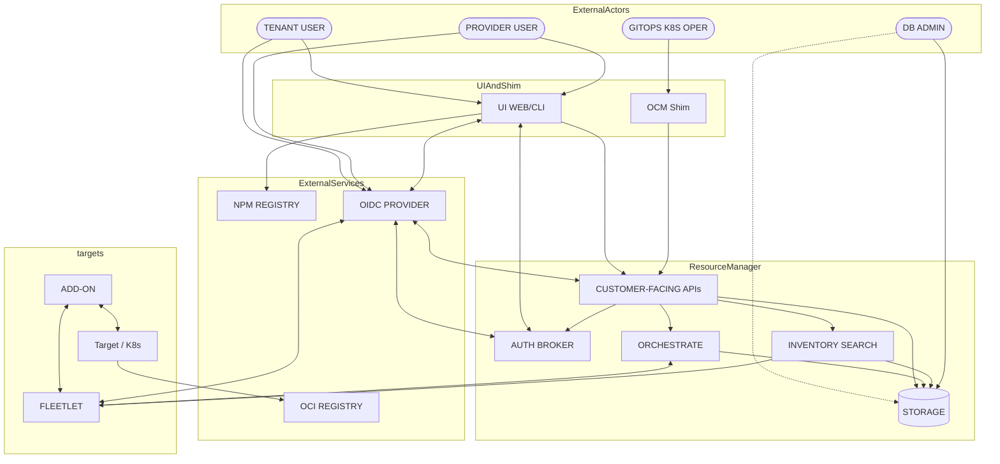

# FleetShift threat model

**Status:** Unratified draft  
**Modeled version:** intended architecture at commit `93c8da00129ade559e476177f33c40b2231f0b5f`  
**Date:** 2026-10-16  
**Triage policy:** strict. Assumptions and inferences escalate; they do not close reports.  
**Generation:** GPT-5.6 Luna; high effort; threat-model skill; OpenSSF and CNSC references.  
**Confidence:** documented 31 / maintainer 9 / inferred 8 / assumption 0

This model describes FleetShift's intended security contract. Design claims are not implementation evidence. A control marked planned or unresolved receives no residual-risk credit.

## 1. Scope and intended use

FleetShift manages declarative infrastructure for multiple tenants and targets. The primary profile is a shared multi-tenant management plane. Provider/factory and recursive-platform deployments are included as profile variants. Product code is in scope; POCs are evidence only; archived designs and unshipped examples are out of scope.

## 2. Trust boundaries and data flow

The resource manager is trusted for ordinary API authorization and availability in the normal case. A provenance-verifying delivery agent does not trust it to author user intent. A target-local credential and target-native policy remain separate enforcement points. Direct proxy or break-glass paths have their own controls.

## 3. Deployment profiles

| Profile | Main boundary | Important residual risk |
| --- | --- | --- |
| Local/sandbox | One operator and one instance | Host privileges and setup exposure dominate. |
| Shared multi-tenant | Tenant/workspace authorization inside one platform | RM, database, addon, and shared-runtime compromise can have broad blast radius. |
| Provider/factory | Consumer intent crosses a provider boundary to factory targets | Factory credentials, channel profiles, and tenant intent must be independently constrained. |

## 4. Assumptions

- Cryptographic algorithms, TLS, and platform isolation work as specified. *(documented, Trust model v3 §3)*
- Trust roots, identity providers, target APIs, and target verifiers are separately administered authorities. *(maintainer, 2026-10)*
- Bootstrap and explicit recovery are controlled ceremonies. *(maintainer, 2026-10)*
- A verifier that has been initialized never silently returns to TOFU. *(documented, Trust model v3 §3 and §6)*
- Users and automation protect their signing keys and approve the intended content. *(documented, Trust model v3 §3, controlled-client considerations)*
- Exact security properties apply only on paths that reach an enforcing delivery agent. *(documented, Trust model v3 §3, enforcement boundary)*

## 5. Adversaries

| Actor | In scope | Capabilities excluded | Goals |
| --- | --- | --- | --- |
| Network attacker | Intercept, replay, delay, or reorder traffic | Break cryptography or compromise both endpoints | Spoofing, tampering, disclosure, denial of service |
| Malicious tenant user | Submit authorized API requests and crafted inputs | Provider trust-root control or another tenant's credentials | Cross-tenant access, unauthorized delivery, data disclosure |
| Compromised resource manager | Alter database state, bypass RM checks, omit or replay evidence, route traffic | Forge retained user provenance or rewrite an established verifier checkpoint | Unauthorized changes, tenant escape, denial of service |
| Compromised addon/UI plugin | Execute declared addon or browser code and send its protocol traffic | Undeclared signing-key, trust-root, or platform-admin authority | Malicious output, data theft, lateral movement |
| Compromised fleetlet/agent | Control one target-side transport or verifier | Other targets' local credentials and trust state | Local compromise, lateral movement, channel abuse |
| Compromised target/host | Control one target or host | RM, other targets, or independent trust roots | Local persistence, credential theft, lateral movement |
| Malicious or compromised authority | Issue valid credentials or trust updates within its authority | Authority outside its configured scope | Identity takeover, broad signing, trust substitution |
| Insider/colluding actors | Combine the capabilities of named actors | Capabilities not supplied by the collusion | Defeat separation of duties and accountability |

Root on the host running FleetShift or a target is not expected to preserve that host's own security. The model instead tests whether compromise spreads beyond that host or target.

## 6. Security properties provided

| ID | Property and conditions | Violation symptom | Tier | Evidence |
| --- | --- | --- | --- | --- |
| P-AUTHZ | Honest RM enforces tenant, workspace, resource, and target authorization. | integrity-bypass | security-critical | *(documented, tenancy_and_permissions.md, Resource hierarchy)* |
| P-PROV | An enforcing verifier rejects altered or fabricated provenance and exact signed content. | integrity-bypass | security-critical | *(documented, security.md §Governing Principle)* |
| P-TRUST | Initialized verifiers reject unauthorized trust replacement and rollback. | integrity-bypass | security-critical | *(documented, trust_model_v3.md §3 and §6)* |
| P-GEN | Targets reject stale generations and replayed work after newer accepted work. | wrong-output | security-critical | *(documented, target_delivery_contract.md §Generation ordering)* |
| P-SCOPE | Evidence binds tenant, target, fulfillment, purpose, and relevant constraints. | integrity-bypass | security-critical | *(documented, provenance.md §Evidence and Attestation Semantics)* |
| P-CRED | Selected credential presentation uses the configured identity and scope. | spoofing / integrity-bypass | security-critical | *(documented, authentication.md §Credential Verification)* |
| P-RETRY | Accepted delivery is durable enough for safe retry and idempotent convergence. | wrong-output / x-unsafe-retry | security-critical | *(documented, target_delivery_contract.md §Guarantees)* |
| P-CAP | Enabled addons receive only declared capability paths. | integrity-bypass | security-critical | *(maintainer, 2026-10)* |
| P-LATERAL | Compromise of one target or addon does not itself authorize other targets or tenants. | integrity-bypass | security-critical | *(maintainer, 2026-10)* |
| P-AVAIL | An unprivileged tenant cannot create an unbounded or cross-tenant outage in an honest deployment. | x-cross-tenant-outage | security-critical | *(maintainer, 2026-10)* |

P-AVAIL is not yet backed by defined quotas and resource limits. The stronger goal of continued service after RM/database compromise is currently a design gap, not a provided property.

## 7. Properties not provided

| ID | Disclaimer | Tier |
| --- | --- | --- |
| D-RM-CONF | A compromised RM and database can read platform-held desired state, inventory, credentials it stores, and query data. | security-critical |
| D-RM-READ | A compromised RM can omit, delay, or falsify ordinary reads and observations. | security-critical |
| D-RM-DOS | A compromised RM can withhold delivery or cause `PausedAuth` and denial of service. | security-critical |
| D-TARGET-ROOT | FleetShift does not preserve a target's integrity after target-host or verifier-root compromise. | security-critical |
| D-GLOBAL-FORK | Continuity/v3 does not provide global fork detection without witnesses or gossip. | correctness-only |
| D-WALL-CLOCK | Continuity/v3 does not provide trusted wall-clock freshness by itself. | correctness-only |
| D-CRED-ONLY | Credential-only delivery does not bind exact content against a compromised courier. | security-critical |
| D-POLICY-REPLICA | A target does not reproduce all RM tenant/workspace policy. | security-critical |
| D-QUOTA | Exact resource quotas and cross-tenant resource-performance isolation are not defined. | security-critical |

## 8. Downstream responsibilities

- Protect signing keys, browser signing boundaries, operator credentials, and recovery material.
- Use target-side provenance verification for protection against RM compromise.
- Treat credential-only and platform-held credentials as distinct risk choices.
- Restrict and authenticate bootstrap, trust updates, fleetlet updates, and recovery.
- Configure tenant/workspace grants, target scopes, quotas, rate limits, and audit retention.
- Do not expose direct target mutation paths when verifier enforcement is required.
- Constrain addon installation, UI asset hosting, dynamic schemas, and external registries.
- Keep target credentials local or short-lived where possible.
- Monitor trust changes, break-glass sessions, unusual delivery volume, and cross-tenant access.

## 9. Known misuse patterns

- Treating a credential-only delivery as protected from a malicious RM.
- Exposing `/setup`, TOFU, or recovery to an untrusted network.
- Enabling a protocol proxy on a hardened factory target.
- Loading an addon UI from an uncontrolled host while allowing it to share signing state.
- Treating RM audit logs as independent proof after RM compromise.
- Using a shared provider credential where a scoped delegation or target-local identity is available.
- Reusing a signed creation assertion after deletion without a retained nonce or tombstone.

## 10. Open questions

- **Q1** — What exact quotas, rate limits, and isolation mechanisms enforce P-AVAIL?
  - Proposed answer: define per-tenant API, delivery, storage, fan-out, and target-resource budgets.
  - Lands in: P-AVAIL, §1.6, §1.11.
- **Q2** — Which credential modes are supported for each target profile, and what minimum scope is required?
  - Proposed answer: support all modes, but require an explicit risk declaration and target policy for each.
  - Lands in: §1.6, P-CRED, D-CRED-ONLY.
- **Q3** — How is tenant isolation enforced beyond authorization in a shared process and database?
  - Proposed answer: define storage, cache, runtime, and workload isolation; otherwise recommend recursive instances for stronger boundaries.
  - Lands in: P-LATERAL, §1.4, §1.11.
- **Q4** — What independent recovery protects availability when the RM and database are compromised?
  - Proposed answer: define an independently hosted control/recovery path or state that only safe target continuity is guaranteed.
  - Lands in: P-AVAIL and D-RM-DOS.
- **Q5** — Which release, SBOM, signing, disclosure, and incident-response practices are normative?
  - Proposed answer: document supported practices and owners before marking the self-assessment complete.
  - Lands in: self-assessment and §1.9.
- **Q6** — What controls protect dynamic UI assets and addon-supplied schemas from substitution?
  - Proposed answer: pin immutable artifacts, authenticate registrations, validate schemas, and isolate signing UI.
  - Lands in: P-CAP and §1.6.
- **Q7** — Which direct proxy and break-glass paths are allowed in each target profile?
  - Proposed answer: hardened factory profiles omit protocol channels; exceptions require signed, scoped, expiring approval.
  - Lands in: P-SCOPE, D-POLICY-REPLICA, and §1.3.
- **Q8** — What historical findings and maintainer rulings should be used for backtesting?
  - Proposed answer: assemble a de-identified corpus before acceptance.
  - Lands in: backtest and §1.15.

## 11. Triage dispositions

Use exactly one route, in this order: `KNOWN-NON-FINDING`; unsupported component; unsupported configuration; dependency contract; trusted input; excluded adversary; disclaimed property; `VALID`; `VALID-HARDENING`; `MODEL-GAP`. In this strict draft, any closing route licensed only by an unresolved question is escalated.

## 12. Change triggers

Revise this model when FleetShift adds a trust boundary, target profile, credential mode, direct mutation path, dynamic-code path, tenant-isolation mechanism, recovery path, or security-relevant dependency. Any finding that cannot be routed uniquely is also a revision trigger.
